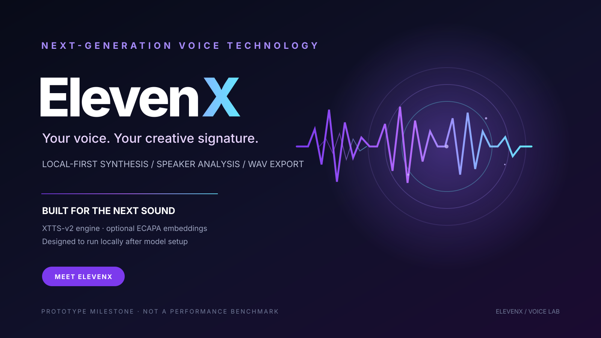
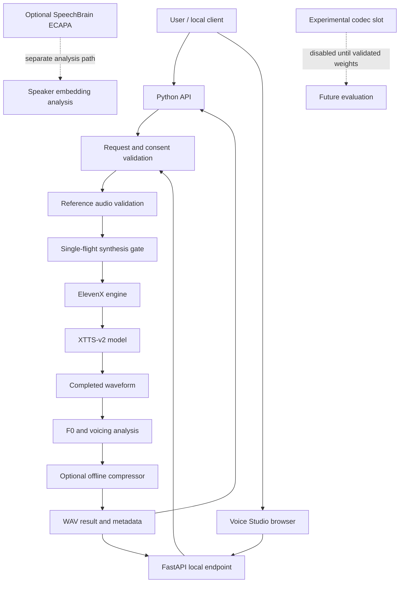
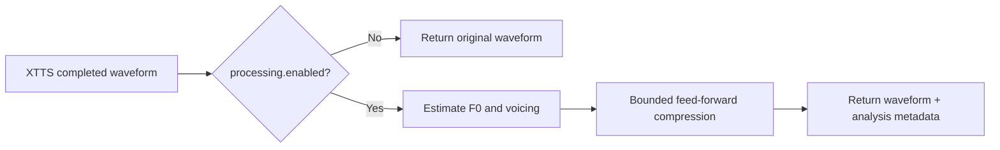
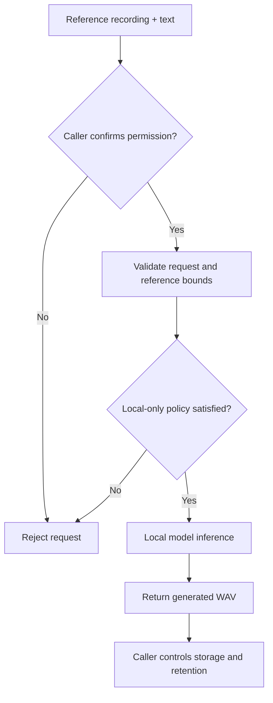
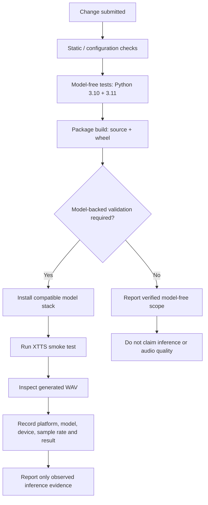
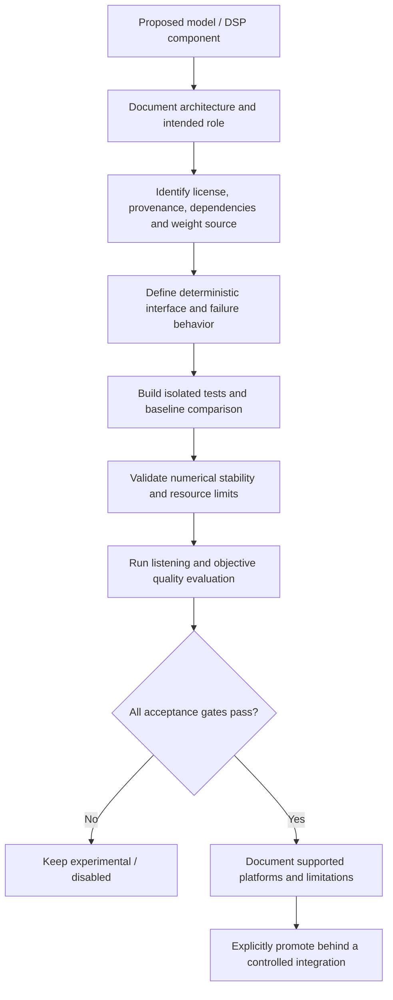

Copyright © 2026 Lewis James Seals Jr. All rights reserved.

THE SOFTWARE IS PROVIDED "AS IS", WITHOUT WARRANTY OF ANY KIND, EXPRESS OR
IMPLIED, INCLUDING BUT NOT LIMITED TO THE WARRANTIES OF MERCHANTABILITY,
FITNESS FOR A PARTICULAR PURPOSE AND NONINFRINGEMENT.

# ElevenX



**Local-first voice synthesis, analysis, and controlled post-processing.**

> I don't compete. I replace.

That line is a product slogan, not a benchmark or a claim of superiority.

ElevenX is a Python voice-synthesis prototype built around Coqui XTTS-v2. It provides a local Python interface, an optional FastAPI/Voice Studio interface, explicit reference-voice permission checks, serialized synthesis requests, lightweight vocal analysis, and a bounded offline dynamics stage. Optional speaker embeddings and experimental codec work are kept outside the default synthesis path.

This README is written as an engineering specification and operating manual. It distinguishes implemented behavior from optional dependencies, research directions, and capabilities that have not been demonstrated.

## 1. Engineering scope and evidence boundary

### Implemented in the current repository

- XTTS-v2 is the primary model-backed synthesis engine and is loaded lazily.
- Synthesis accepts text, language, a reference recording, and a named delivery preset.
- Reference audio duration is bounded by configuration (3–30 seconds in the supplied configuration).
- A local API and browser Voice Studio are available.
- API access is local-only by default. The application checks the bind address, client address, and Host header; malformed or missing security configuration fails closed.
- Synthesis is serialized. A concurrent synthesis request is rejected with HTTP 503 and a `Retry-After` hint rather than being added to an unbounded model-call queue.
- Blocking model inference is moved off the asynchronous request loop.
- The output sample rate is taken from the loaded model when it exposes that value.
- Optional F0/voicing analysis and a deterministic offline compressor operate on the completed waveform.
- Optional SpeechBrain ECAPA embeddings are a separate speaker-analysis capability; they are not XTTS conditioning latents.
- Model-free tests are designed to run without downloading large model weights or requiring a GPU.

### Explicitly not claimed

ElevenX is not currently a verified real-time streaming synthesizer, a production deployment platform, a validated speaker-identity system, or a certified audio mastering processor. The repository does not establish sub-10-ms latency, 99.97% voice similarity, hardware-grade dynamics behavior, or perceptual equivalence to a human performance.

A passing model-free test suite proves the behavior covered by those tests. It does not prove that XTTS weights load correctly on every machine, that a particular GPU is supported, or that generated speech meets a subjective quality target.

## 2. System architecture

The design separates request handling, model inference, and post-synthesis processing. The API is an interface around the engine; it is not itself the synthesis model.



### Component responsibilities

| Component | Responsibility | Boundary |
|---|---|---|
| `ElevenXEngine` | Loads configuration and coordinates synthesis | Model-backed; lazy load |
| XTTS-v2 | Generates the speech waveform | Model and device dependent |
| Reference validation | Checks supplied audio and duration | Permission is the caller's responsibility |
| Emotion presets | Selects configured sampling/speed hints | Not calibrated emotion control |
| Vocal analysis | Estimates F0 and voiced fraction | Monophonic estimate, not identity verification |
| Offline compressor | Applies bounded dynamics to a completed waveform | Not a real-time audio callback |
| FastAPI | Exposes local HTTP routes | No built-in user authentication |
| Voice Studio | Browser interface for local requests | Not a public multi-user service |
| ECAPA option | Produces speaker-analysis embeddings | Separate from XTTS conditioning |
| Codec slot | Reserved for future codec work | Disabled until trained weights and quality gates exist |

## 3. End-to-end synthesis workflow

The request path is deliberately bounded. Validation happens before model inference; only one synthesis call is admitted at a time; processing happens after a complete waveform exists.

```mermaid
sequenceDiagram
    autonumber
    actor User
    participant UI as Python client / Voice Studio
    participant API as FastAPI
    participant Gate as Validation + single-flight gate
    participant Engine as ElevenX engine
    participant Model as XTTS-v2
    participant DSP as Offline analysis / compressor

    User->>UI: Enter text, language, preset, reference
    UI->>API: POST /v1/synthesize (or call Python API)
    API->>Gate: Validate request, consent, network boundary
    Gate->>Gate: Validate reference format and 3–30 s duration
    alt Another synthesis is active
        Gate-->>API: Reject with HTTP 503 + Retry-After
        API-->>UI: Busy response
    else Request admitted
        Gate->>Engine: Admit one synthesis operation
        Engine->>Model: Lazy-load if required; synthesize
        Model-->>Engine: Complete waveform
        Engine->>DSP: Analyze and optionally compress
        DSP-->>Engine: Processed waveform + analysis metadata
        Engine-->>API: Synthesis result
        API-->>UI: WAV response
        UI-->>User: Playback / save output
    end
```

### Request contract

The HTTP synthesis route is `POST /v1/synthesize`. It accepts multipart form data containing:

- `text` — text to synthesize.
- `language` — XTTS language identifier.
- `emotion` — one of the configured preset names.
- `consent` — explicit confirmation that the caller has permission to use the reference voice.
- `reference_audio` — the reference recording.

The health route `GET /health` is a process health check. It is not proof that XTTS weights are loaded or that a synthesis request will succeed.

A busy synthesis gate returns HTTP 503 and `Retry-After: 3`. Clients should wait before retrying; they should not create repeated concurrent requests.

## 4. Audio processing model

The supplied configuration uses a 24 kHz mono output target and enables a conservative post-synthesis compressor. The actual returned sample rate prefers the loaded model's declared rate when available.

### Analysis

The synthesis result can expose:

- `f0_median_hz` — median estimated fundamental frequency over voiced frames.
- `voiced_fraction` — fraction of analyzed frames classified as voiced.
- `pitch_frames` — frame-level pitch estimates.

F0 is estimated using windowed normalized autocorrelation. It is a monophonic pitch estimate. It is not polyphonic transcription, singer verification, emotion recognition, or proof that two voices belong to the same person.

### Dynamics

The compressor is a deterministic feed-forward stage applied to a completed waveform. The supplied defaults are:

| Parameter | Default | Meaning |
|---|---:|---|
| Enabled | `true` | Run analysis and compression |
| Threshold | `-18 dB` | Level at which compression begins |
| Ratio | `3:1` | Compression ratio above threshold |
| Attack | `10 ms` | Gain-reduction response time |
| Release | `100 ms` | Recovery time |
| Makeup | `0 dB` | Output gain compensation |
| Maximum reduction | `12 dB` | Bound on gain reduction |

Set `processing.enabled: false` to bypass both analysis and compression. This stage is not a live audio callback, does not process samples concurrently with XTTS generation, and does not establish mastering-grade loudness or true-peak compliance.



## 5. Security, privacy, and consent

### Default operating boundary

The supplied `config.yaml` sets:

- Host: `127.0.0.1`
- Port: `8000`
- `security.allow_remote_api: false`
- Maximum text length: 5,000 characters
- Speaker encoder loading: disabled
- Codec: disabled

The API's local-only policy checks the server bind, remote client address, and Host header. A wildcard bind or a non-loopback request is rejected while remote access is disabled. Missing or malformed security configuration fails closed.

The remote-access switch is not authentication. Do not expose the API to a network or the public internet merely by setting `allow_remote_api: true`. A deliberate remote deployment would still require, at minimum, authenticated identity, TLS, request quotas, abuse controls, secure model/cache handling, and auditable consent procedures.

### Voice permission

Use only reference recordings that you own or are explicitly authorized to use. The request's `consent` field is an application-level confirmation; it does not independently establish legal permission or verify the speaker's identity.

### Data flow



Model weights may be downloaded during first use. For an offline environment, pre-cache the required weights, verify the model source and local cache contents, and test the full synthesis path before disconnecting the machine.

## 6. Installation and supported Python versions

The authoritative package metadata in `pyproject.toml` currently declares:

```toml
requires-python = ">=3.10,<3.12"
```

The supported interpreter range is therefore Python 3.10 and Python 3.11. The CI model-free test matrix covers both versions. Do not infer support for Python 3.9 or 3.12 from a local environment or from a separate compatibility proposal.

### Create an environment

Python 3.10 or 3.11 is required.

```bash
python -m venv .venv

# macOS / Linux
source .venv/bin/activate

# Windows PowerShell
.venv\Scripts\Activate.ps1

python -m pip install --upgrade pip
```

### Install the project

The project metadata includes the model-backed dependency set. PyTorch and audio package compatibility depends on the operating system, Python version, and accelerator. Select a compatible PyTorch build for the target machine before attempting GPU-specific use.

```bash
python -m pip install -e ".[test]"
```

Optional speaker embeddings:

```bash
python -m pip install -e ".[speaker]"
```

The model-free CI workflow intentionally installs the test/runtime surface without resolving or downloading the full XTTS model stack. Consequently, a green model-free CI run is not equivalent to a successful full model installation. Verify the documented install and run the model-backed smoke test on the target platform.

## 7. Run ElevenX

### Voice Studio / local API

From the repository root, with the project installed:

```bash
python -m elevenx.api
```

Open:

```text
http://127.0.0.1:8000/
```

The browser interface supports script entry, language and delivery-style selection, explicit voice-permission confirmation, reference audio upload, playback, and WAV download. Keep the service on loopback for normal use.

### Python API

```python
from elevenx import ElevenXEngine

engine = ElevenXEngine("config.yaml")
result = engine.synthesize(
    text="Welcome to ElevenX.",
    reference_audio="reference.wav",
    language="en",
    emotion="neutral",
)

engine.save_wav(result, "output/elevenx.wav")
print(result.sample_rate, result.duration_seconds)
```

Use a clean reference recording you are authorized to use. The supplied configuration bounds reference duration to 3–30 seconds.

## 8. Verification strategy

ElevenX separates fast, deterministic model-free checks from opt-in model-backed validation.



### Model-free tests

Install test dependencies and run:

```bash
python -m pip install -e ".[test]"
python -m pytest -q
```

The suite is intended to cover application behavior such as API health responses, overlapping-request rejection, invalid or empty reference uploads, upload-size enforcement, WAV responses, cleanup after success/failure, preset validation, configured sample-rate behavior, and preference for the loaded model's declared output sample rate.

The exact test inventory can evolve. Treat the test output from the commit under review as the evidence for that commit; this README is not a substitute for a CI run.

### Model-backed smoke test

After installing a compatible model stack and obtaining a reference recording with permission:

```bash
python scripts/smoke_xtts.py \
  --reference /path/to/consented-reference.wav \
  --output elevenx-smoke.wav
```

The smoke test loads XTTS-v2, synthesizes a short phrase, writes a WAV, and checks basic file/audio invariants. Model weights may download on first run. Play the resulting WAV in a separate audio player. A successful file check does not certify the browser, audio driver, playback device, perceptual quality, or production readiness.

### CI interpretation

The current model-free workflow uses Python 3.10 and 3.11. It does not download large model weights or require a GPU. Build success proves that the source and wheel distributions can be produced by that workflow; it does not prove the optional model stack is installable on every platform.

## 9. Repository map

The source tree is organized around the Python package, tests, scripts, configuration, and documentation. The following is a functional map rather than an exhaustive generated file listing.

```text
ElevenX/
├── .github/
│   └── workflows/       # CI workflows
├── config.yaml          # Runtime, model, processing and security defaults
├── docs/                # Product and engineering documentation
├── scripts/
│   └── smoke_xtts.py    # Opt-in model-backed smoke test
├── src/
│   └── elevenx/
│       ├── api.py       # FastAPI routes and local service
│       ├── engine.py    # Synthesis orchestration
│       ├── emotions.py  # Delivery preset configuration/validation
│       ├── speakers.py  # Optional speaker-analysis integration
│       ├── audio_processing.py
│       └── static/      # Browser Voice Studio assets
├── tests/               # Model-free regression tests
├── pyproject.toml       # Package metadata and supported Python range
└── README.md
```

Consult the checked-out tree for the exact current module inventory; modules may be added as features evolve.

## 10. Research and extension governance

New audio models and processing modules should be integrated through evidence-gated interfaces, not by silently replacing the established synthesis path.

### Promotion workflow



### Existing research boundaries

- **SingerFlow:** the integration follows a published algorithm description; it does not claim to copy or reproduce its source implementation.
- **Neural-Compressor-Script:** a training harness is not automatically a production inference/export artifact. Do not load unverified weights or imply that training code is a deployed compressor.
- **HarmoniaCodec:** remains disabled. No trained weights or verified streaming decoder are assumed. Random initialization is not a usable codec.
- **SpeechBrain ECAPA:** optional speaker-analysis functionality only; its embedding is not a drop-in XTTS voice-conditioning vector.
- **Spatial/HRTF and streaming work:** future research until implementation, latency, and listening tests establish their behavior.

### Minimum acceptance record

For every promoted model or DSP feature, record:

1. Source repository, author, license, exact revision, and weight provenance.
2. Model architecture, tensor/sample-rate conventions, and runtime dependencies.
3. Input validation, output contract, error behavior, and resource limits.
4. Reproducible baseline and regression tests.
5. Numerical stability, clipping/NaN handling, and performance measurements.
6. Listening protocol and objective metrics appropriate to the claimed capability.
7. Supported Python/platform/device matrix and known failure modes.
8. Evidence that the feature is enabled in the shipped runtime rather than merely present in the repository.

## 11. Known limitations and next engineering gates

- Synthesis returns a completed waveform; it is not true streaming.
- A WebSocket transport alone cannot guarantee low end-to-end synthesis latency.
- Emotion names are sampling/speed presets, not calibrated emotion controls.
- ECAPA embeddings are not XTTS conditioning latents.
- A 24 kHz signal has a 12 kHz Nyquist limit; it cannot represent a 20 kHz upper band.
- The offline compressor is not a real-time mastering chain and does not certify loudness or true peak.
- The local API has no built-in user authentication or rate limiting.
- XTTS model installation and inference must be verified separately for each target environment.
- Codec, streaming, spatial processing, and model-trained enhancement remain gated research work.

A sensible next release gate is to make the model-backed install and inference path reproducible on a declared platform matrix, then add audio-quality acceptance tests with recorded baselines. Until that evidence exists, preserve the distinction between a working model-free application layer and a verified model-backed voice product.

## 12. Troubleshooting: playback queue reports too few elements

The application serializes synthesis and moves blocking inference away from the API event loop. It returns a completed WAV; it does not implement a real-time streaming playback queue.

If the error appears:

1. Determine whether it occurs during synthesis, while the browser is playing, or in an external player.
2. Download the WAV and open it in a separate audio player.
3. Record the full error text, operating system, browser/player, and whether the WAV plays elsewhere.
4. Check the output file's duration and sample rate.
5. Compare the result from the same reference/text using the Python API and Voice Studio.

If the downloaded WAV plays in another player, investigate the browser/audio-device path before changing synthesis DSP. If the WAV itself is empty, malformed, or truncated, capture the synthesis logs and reproduce with the model-backed smoke test.

## 13. License and warranty

This repository currently carries an all-rights-reserved copyright and an "AS IS" warranty disclaimer in this README. Do not assume that the presence of a warranty disclaimer grants an open-source license or permission to redistribute the project, its dependencies, model weights, or reference recordings. Review each upstream model and dependency license independently before redistribution or commercial deployment.
